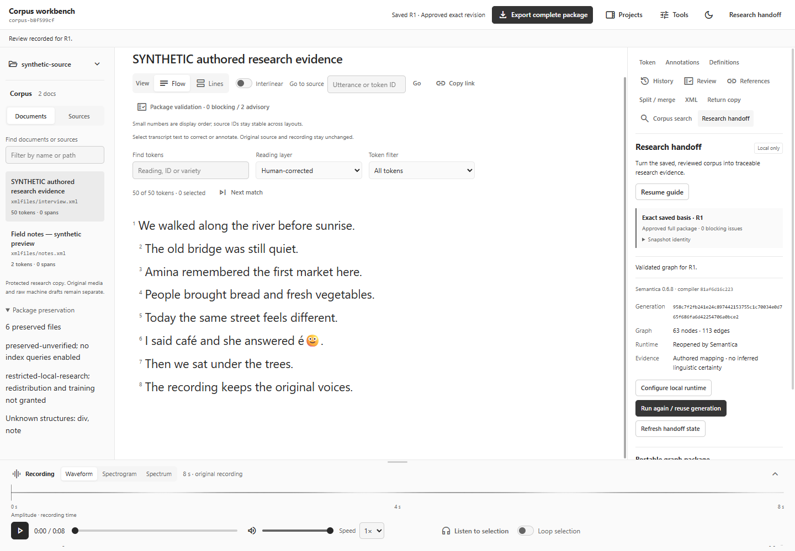
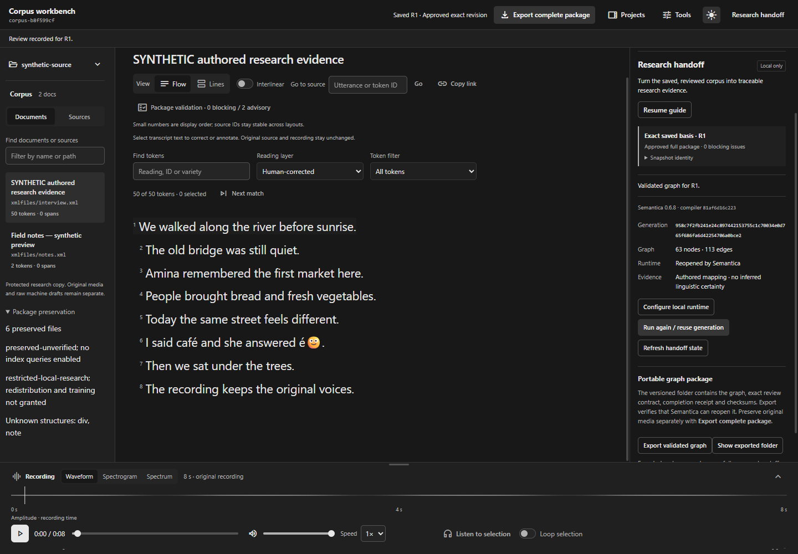

# Reviewed corpus to local Semantica

Qualified locally on 2026-10-15, based on workbench `604ba503cb84c77a5fce26c79577083c8ea17a7c` plus this scoped change. The desktop now exposes the existing authored-evidence adapter and validates a portable schema-1 handoff. See the [operator and format contract](SEMANTIC-HANDOFF.md).

The optional guide links preserved source, corrections, uncertainty notes, exact saved review and research handoff. It never creates approval or discards drafts. Runtime selection stays native; the renderer supplies revision/generation identities, not executable paths. Playback remains available while a bounded local process runs. Accepted evidence and verified portable export have separate states.

Actual local execution used Python 3.13.14, installed Semantica 0.6.8 and a clean compatible compiler at `81af6d16c223582d1b6ba54549831bb050b07302`. No compiler code, runtime install, external graph database or model extraction was changed or enabled. Only native file dialogs were substituted in the Electron journey; compilation, backend acceptance, disk exports and ContextGraph reopening executed normally.

- [Native Electron evidence](../evidence/research-handoff/native-qualification.json): 63 nodes/113 authored edges; exact R1 approval, real compilation/reopen, repeat-run reuse, independent portable consumption, relaunch, R2 edit/approval/new generation and rejection invalidation. Zero page/console errors. Synthetic raw JSON/audio hashes remained unchanged.
- [Expanded adapter evidence](../evidence/research-handoff/adapter-qualification.json): original/corrected readings, uncertainty note/annotation/custom variety, unknown word times/provenance, review and source artifact identities survive the exported graph. Rejection and explicit reapproval/retry, tamper rejection, structural history and qualified duplicate IDs are exercised. Final independent package reopening succeeded after removal of the temporary authoring workspace: 8 nodes/12 edges, four payload checksums verified.
- Public automated checks cover the native export boundary, 21 Python runtime/package cases, 30 desktop control-plane tests and ten research UI flows. Doubles test orchestration behavior and do not stand in for the actual runtime evidence above.

The retained test authorities intentionally exercise later rejection. Their earlier exported packages remain verified snapshots, not perpetually current evidence. Native current queries recheck the live head and latest approval. Detached consumers cannot observe later authoring changes.

The [compact view](../evidence/research-handoff/research-export-compact-dark.png), [optional guide](../evidence/research-handoff/research-guide-light.png) and [rejection state](../evidence/research-handoff/research-rejected-dark.png) use generated text and a tone. They contain no private corpus media.

The later [local input preparation boundary](LOCAL-TRANSCRIPT-IMPORT.md) adds recording plus existing transcript import; this milestone's retained qualification used a prepared package. This is authored evidence mapping, not ASR, forced alignment, linguistic certainty assessment, model inference or a remote database delivery. The compatible compiler/runtime remains separately supplied; runtime fingerprints are not a portable dependency lock. Windows local qualification and hosted platform checks do not establish real-corpus linguistic accuracy, physical power-loss recovery, production readiness or Raspberry Pi performance.
