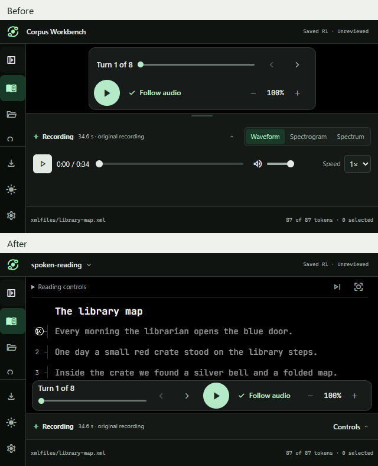

# Workbench UI and interaction audit

23 November 2026

The audit followed a researcher from opening a project through reading, listening, correcting a passage, collecting training examples, reviewing evidence and exporting it. The comparison below shows the same eight-turn practice transcript in a 640 × 360 touch viewport.

| Surface | What got in the way | What changed |
| --- | --- | --- |
| Remote sign-in | An expired launcher link ended at an authorization error. The sign-in form lost contrast in dark mode. | The browser offers sign-in again or accepts a fresh session code. Invalid submissions return focus to the field. |
| Desktop library and import | On a 1060 × 720 window, format help pushed the import action 299 px below the viewport. Keyboard focus fell back to the page after choosing files. | Recent projects come first. The preview scrolls between its heading and action bar. Choosing files focuses the preview, and canceling returns focus to the chooser. |
| Project files and workspace navigation | The phone title bar hid the project name. The source browser showed storage role codes. A user who filtered out all files had to edit the query manually. | The title bar identifies the open project and opens its files. Sources show a filename, containing folder and readable group. A clear action restores the list. Phone panes offer a visible return to the transcript. |
| Reading and recording | The transcript had 20 px of height in phone landscape. The steering dock took 124 px and the default desktop text was 11 px. | The short-window dock takes 58 px and the recording details open on demand. The reading area is 172 px tall. Default desktop text is 14 px, with adjustable zoom. |
| Listening while using tools | A linked recording occupied 254 px of a portrait phone while browsing or searching. In landscape the play button sat behind the open tool. | Phone tools keep play/pause and recording controls in a 45 px bar. This returns 209 px to the library and inspector on a 390 × 844 phone. Expanding controls preserves playback position and speed. |
| Passage correction and training gesture | Draft actions were hard to hit on touch. During a held gesture, upcoming words brightened behind the lens. | Touch correction actions have 44 px targets and stay in view. The lens dims its surroundings, keeps the selected passage readable, and respects reduced motion. |
| Co-analysis, training and history | A direct shortcut could land above thirteen other tool choices instead of the requested activity. | The selected tool opens directly, receives keyboard focus and keeps the passage selection. The other tools remain available from the inspector disclosure. |
| Corpus search, review and handoff | On a 390 × 844 screen, optional search settings preceded the submit action and hits. The dark primary action measured 1.30:1 contrast. Review and handoff decisions followed explanatory material. | Query and submit lead into results. Search options are expandable. The review decision and handoff readiness appear first. Dark primary actions measure 14.70:1 contrast. |
| Research overview | The desktop diagram shrank its file labels to about 5 px on a phone. Documents without a recording still displayed a large empty chart. | The compact overview lists filenames at reading size. A text-only document shows its recording status and uses the space for the evidence inventory. |

## Repeating the audit

Use a disposable local project for writes, review decisions and export. The portal, desktop import, reader, editor, inspector and export each have a separate failure mode.

1. Open an expired preview link, then sign in with a current code. Open a recent desktop project with the keyboard. Import a synthetic transcript with format help expanded and verify the action bar stays visible.
2. Read a linked recording in portrait and landscape. Play, pause and seek backward. Check that the caret follows timed words, the completed turns stay brighter and reopening recording controls preserves playback position.
3. Drag forward and backward across words. Open a correction, a passage menu and the held training lens. Dismiss each with Escape. Check contrast in light and dark themes and repeat with reduced motion.
4. With a passage selected, open co-analysis, training, history and corpus search from the rail. Exercise an empty filter, a matching query and a source preview. Return to the transcript using only the keyboard.
5. Review the saved evidence, export training JSONL and download the complete package. Open the overview on documents with and without audio. Check that names, available actions and revision information remain readable at 390 px.

The browser exercises use a local Rust authority and synthetic recorded or text-only fixtures. The import exercise uses Windows Electron. Automated accessibility scans complement the keyboard, pointer, touch-emulation and visual checks. Physical-device and screen-reader usability testing remain separate validation work.
