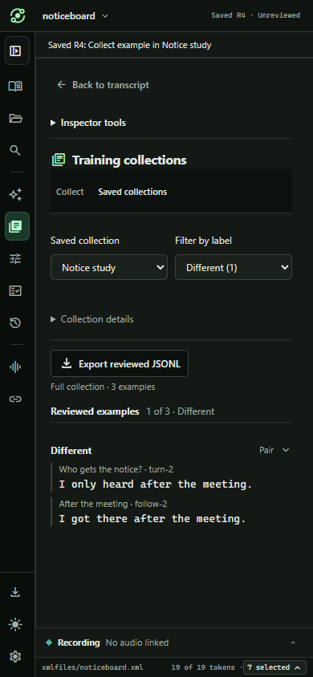
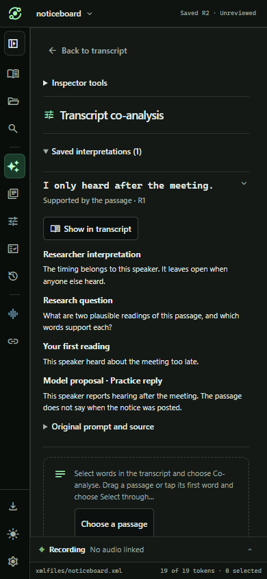

# From a spoken passage to a reviewed example

23 November 2026

This design pass followed a researcher trying to collect training examples from a recording. The earlier audit measured layout, contrast and navigation. Here the question was whether a researcher could select exactly the intended words, hear enough to judge what they meant, and find the judgment again. The priorities below reflect where an error affects the evidence or its interpretation. We have no usage telemetry to estimate how often each difficulty occurs.

| Priority | What we found in the Workbench | Design decision and evidence |
| --- | --- | --- |
| 1. Choose exact words on a phone | The canvas supported dragging and Shift-click. Keeping contact across wrapped lines or reaching for a keyboard made a simple range harder to specify. | Tap the first word, choose **Select through…**, then tap the other endpoint. Selecting backward and canceling use the same interaction. This extends Chuanqi Sun’s phrase-locking idea with a single-pointer alternative. [Spaceship IDE](https://github.com/chuanqisun/spaceship) · [W3C guidance on dragging](https://www.w3.org/WAI/WCAG22/Understanding/dragging-movements) |
| 2. Hear what qualifies a quote | Exact-excerpt playback could stop just before a qualification. Enlarging the example to hear the surrounding speech would also change the training evidence. | **Hear excerpt** plays the supplied interval. **Hear in context** adds up to two seconds on each side, bounded by the recording. The source card identifies word or utterance timing. The two-second window is a Workbench design choice. [Audacity playback around selections](https://manual.audacityteam.org/man/playback.html#Play_short_periods_around_selections) |
| 3. Inspect a collection before export | Saved examples appeared in a single list. A researcher looking for a difficult negative had to scan other judgments and expand rows to compare the words. | Browse by label and count. A pair shows both quotations with their document and turn. The export action states its full-collection scope even while a filter is active. Taguette provides a precedent for browsing coded highlights with their source. [Taguette guide](https://www.taguette.org/getting-started.html) |
| 4. Reopen an interpretation | A saved memo was headed by the decision and token IDs. Those identifiers preserve provenance but give little help to the person who remembers what the speaker said. | Lead with the original quote, then the assessment and revision. Show the researcher’s interpretation above the model proposal. **Show in transcript** selects the passage when its saved wording and source still match. Older wording stays available when the transcript changes. ELAN demonstrates synchronized navigation between source and annotation views. [ELAN navigation](https://www.mpi.nl/corpus/html/elan/ch01s06.html) |

An annotator separately asked doccano to show the filename while labeling. That report informed the decision to put source information beside each comparison. It is evidence of a problem encountered in another tool. [doccano issue 2158](https://github.com/doccano/doccano/issues/2158)

| Finding a pair by its label | Returning to a reviewed interpretation |
| --- | --- |
|  |  |

## What to test with researchers

1. On a phone, select a phrase that wraps across lines. Include a second trial in the opposite direction. Record any wrong source words, retries or requests for help.
2. Compare two utterances with similar wording but different implications. Alternate the order of exact and contextual listening. Ask which words support the final label and check the exported token IDs against that explanation.
3. Ask a researcher to find a previously disputed interpretation and predict which examples the export will contain. Compare the prediction with the JSONL. This checks both retrieval and whether the filter and export scopes are clear.
4. For a later study, compare an optional independent first reading with making it a required step. Measure unsupported agreement with a model as well as time and perceived effort. Buçinca and colleagues found a trade-off between overreliance and user preference in a different decision task. Its transfer to qualitative transcript work is an open question. [Buçinca, Malaya and Gajos, 2021](https://www.eecs.harvard.edu/~kgajos/papers/2021/bucinca2021trust.shtml)

The screenshots use fictional practice dialogue. Browser exercises establish interaction behavior and export contents. The proposed researcher sessions would establish whether these changes improve judgment, learnability and speed in actual fieldwork.
